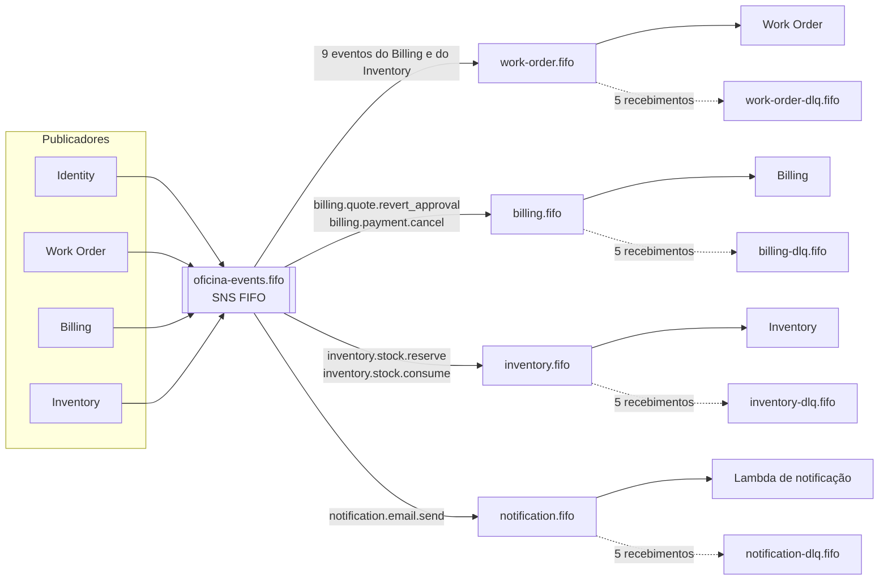
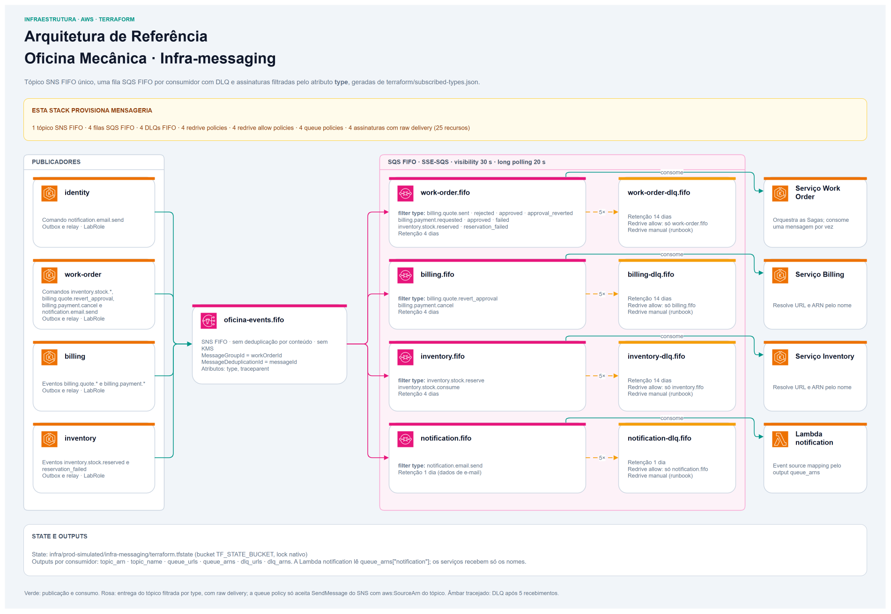
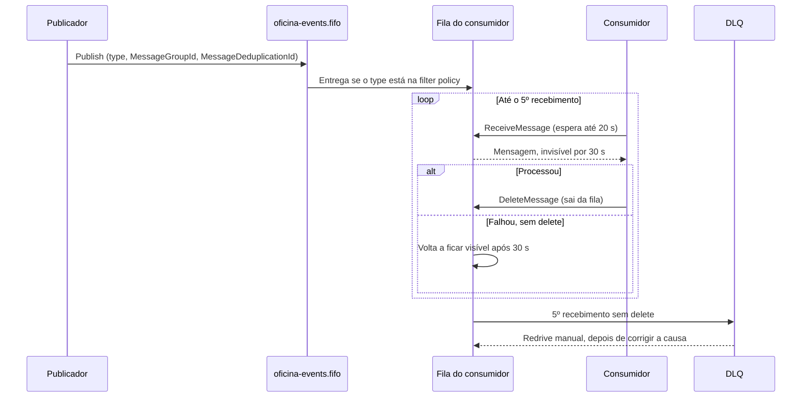

<div align="center">

# 📨 Oficina Mecânica — Mensageria AWS (IaC)

**Tópico SNS FIFO, filas SQS FIFO por consumidor e DLQs da solução Oficina Mecânica, em Terraform, com a mesma topologia reproduzida no LocalStack.**


</div>

## 📋 Sobre

Este repositório contém o código de **Infraestrutura como Código (IaC)**
responsável pelo provisionamento da **mensageria assíncrona** da solução
**Oficina Mecânica**, na AWS.

A solução acompanha o atendimento de uma oficina mecânica, da abertura da
ordem de serviço ao orçamento, ao pagamento e à baixa das peças no estoque.
Ela é dividida em microsserviços, cada um dono do próprio banco, e em duas
Lambdas:

- [Serviço Work Order](https://github.com/FIAP-15SOAT/oficina-mecanica-work-order-service): microsserviço de ordens de serviço e orquestrador das Sagas.
- [Serviço Identity](https://github.com/FIAP-15SOAT/oficina-mecanica-identity-service): usuários, papéis, credenciais e login de funcionários.
- [Serviço Billing](https://github.com/FIAP-15SOAT/oficina-mecanica-billing-service): orçamentos, cobranças e integração com o Mercado Pago.
- [Serviço Inventory](https://github.com/FIAP-15SOAT/oficina-mecanica-inventory-service): catálogo de serviços e peças, saldo e reservas.
- [Lambda de login do cliente](https://github.com/FIAP-15SOAT/oficina-mecanica-lambda-customer-auth): login de cliente por CPF; não usa a mensageria.
- [Lambda de notificação](https://github.com/FIAP-15SOAT/oficina-mecanica-lambda-notification): envio dos e-mails pedidos pelos serviços.

Quando uma operação envolve mais de um serviço, como aprovar um orçamento ou
reservar peças, o Work Order conduz uma Saga trocando comandos e eventos com
os outros serviços por mensagens. Este repositório é o único dono da topologia
por onde essas mensagens passam: todo serviço publica num **tópico SNS FIFO
único**, `oficina-events.fifo`, e cada consumidor lê a **própria fila SQS
FIFO**, que assina o tópico filtrando pelo atributo `type` da mensagem. Cada
fila tem uma DLQ FIFO que recebe a mensagem depois de 5 recebimentos sem
sucesso.



| Consumidor | Fila | Quem lê |
| --- | --- | --- |
| `work-order` | `work-order.fifo` | [Serviço Work Order](https://github.com/FIAP-15SOAT/oficina-mecanica-work-order-service) |
| `billing` | `billing.fifo` | [Serviço Billing](https://github.com/FIAP-15SOAT/oficina-mecanica-billing-service) |
| `inventory` | `inventory.fifo` | [Serviço Inventory](https://github.com/FIAP-15SOAT/oficina-mecanica-inventory-service) |
| `notification` | `notification.fifo` | [Lambda de notificação](https://github.com/FIAP-15SOAT/oficina-mecanica-lambda-notification) |

Os publicadores são os serviços Identity, Work Order, Billing e Inventory, que
gravam a mensagem num outbox na mesma transação do dado e a publicam depois.
As mensagens seguem o envelope `messageId`, `type`, `occurredAt`, `workOrderId`
e `payload`, com os atributos `type` e `traceparent`, `MessageGroupId` igual ao
`workOrderId` (ou ao `messageId`, quando não há OS) e `MessageDeduplicationId`
igual ao `messageId`.

Faz parte do ecossistema de serviços e infraestrutura da pós-graduação em
Arquitetura de Software da FIAP (turma 15SOAT). O
[serviço Work Order](https://github.com/FIAP-15SOAT/oficina-mecanica-work-order-service)
é a entrada central da documentação da solução.

---

### 🏗️ Recursos Provisionados

| Recurso | Tipo | Configuração | Assinatura (filter policy por `type`) |
| --- | --- | --- | --- |
| `oficina-events.fifo` | Tópico SNS FIFO | Sem deduplicação por conteúdo, sem KMS | As 4 filas abaixo, com raw message delivery |
| `work-order.fifo` | Fila SQS FIFO | Retenção de 4 dias | `billing.quote.sent`, `billing.quote.rejected`, `billing.quote.approved`, `billing.quote.approval_reverted`, `billing.payment.requested`, `billing.payment.approved`, `billing.payment.failed`, `inventory.stock.reserved`, `inventory.stock.reservation_failed` |
| `billing.fifo` | Fila SQS FIFO | Retenção de 4 dias | `billing.quote.revert_approval`, `billing.payment.cancel` |
| `inventory.fifo` | Fila SQS FIFO | Retenção de 4 dias | `inventory.stock.reserve`, `inventory.stock.consume` |
| `notification.fifo` | Fila SQS FIFO | Retenção de 1 dia (dados de e-mail) | `notification.email.send` |
| `<consumidor>-dlq.fifo` | DLQ SQS FIFO | Retenção de 14 dias (1 dia na `notification-dlq.fifo`) | Recebe da fila de origem depois de 5 recebimentos |

Em todas as 8 filas: FIFO, sem deduplicação por conteúdo, criptografia SSE
gerenciada pelo SQS, visibility timeout de 30 s e long polling de 20 s. Cada
fila de consumo tem `RedrivePolicy` para a sua DLQ com `maxReceiveCount` 5, e
cada DLQ aceita redrive só da sua fila de origem (`RedriveAllowPolicy`
`byQueue`). A policy de cada fila de consumo só aceita `sqs:SendMessage` do
SNS vindo de `oficina-events.fifo` (`aws:SourceArn`).

Os nomes são fixos e ficam em `terraform/locals.tf`: os serviços os recebem por
ConfigMap e resolvem URL e ARN na inicialização. Não há role de IAM para os
publicadores, porque pods e Lambdas usam a `LabRole`.



#### Como uma mensagem percorre a topologia

- **FIFO (First In, First Out)**: o primeiro a entrar na fila é o primeiro a
  ser processado, ou seja, as mensagens são entregues na ordem de chegada. No
  SNS e no SQS FIFO, a ordem vale dentro de cada `MessageGroupId`. Aqui o grupo
  é a OS, então as mensagens de uma OS são processadas na ordem em que foram
  publicadas, e OSs diferentes andam em paralelo.
- **Deduplicação**: é o descarte de cópias da mesma mensagem. Se o publicador
  enviar a mesma mensagem duas vezes, como num retry do outbox depois de um
  timeout, o tópico e a fila tratam como duplicata toda mensagem com o mesmo
  `MessageDeduplicationId` nos 5 minutos seguintes e entregam só a primeira.
  Aqui o id é o `messageId` do envelope; a deduplicação por conteúdo (hash do
  corpo) está desligada. Uma cópia fora da janela é entregue, por isso os
  consumidores são idempotentes.
- **Filter policy e raw delivery**: cada assinatura entrega à sua fila só os
  tipos do mapa, comparando o atributo `type`; um tipo fora do mapa não chega
  a nenhuma fila. Com raw delivery, a fila recebe o corpo e os atributos como
  foram publicados, sem o envelope JSON do SNS.
- **Long polling (20 s)**: o `ReceiveMessage` espera até 20 s por uma mensagem
  antes de responder vazio. O consumidor faz menos chamadas vazias e recebe a
  mensagem assim que ela chega.
- **Visibility timeout (30 s)**: receber uma mensagem não a remove da fila; ela
  fica invisível para os outros receptores por 30 s. Se o consumidor a processa
  e a apaga (`DeleteMessage`) nesse tempo, ela sai da fila. Se não a apaga, ela
  volta a ficar visível e é entregue de novo.
- **`RedrivePolicy` e `maxReceiveCount` (5)**: o SQS conta quantas vezes cada
  mensagem foi recebida. Em geral, o delete não acontece porque o processamento
  falhou (banco fora, bug, payload inesperado). Como a mensagem volta à fila,
  ela é reprocessada até 5 vezes, o que cobre falhas passageiras. No 5º
  recebimento sem delete, a `RedrivePolicy` a move para a DLQ. Enquanto isso, as
  mensagens seguintes do mesmo grupo esperam, por até cerca de 2,5 min (30 s × 5).
- **DLQ (dead-letter queue)**: é a fila que guarda as mensagens que esgotaram as
  tentativas, para análise, e libera o grupo. Ela retém a mensagem por 14 dias
  (1 dia na `notification-dlq.fifo`) e, pela `RedriveAllowPolicy` `byQueue`, só
  aceita mensagens da sua fila de origem. Não há reprocessamento automático:
  depois de corrigir a causa, o redrive manual devolve as mensagens à fila de
  origem, como mostra o [runbook](docs/runbook.md#redrive-de-uma-dlq).



A subida, a derrubada, o diagnóstico e o redrive estão no [runbook](docs/runbook.md).

---

## 🏷️ Tipos de Mensagem

O mapa consumidor → tipos fica em
[`terraform/subscribed-types.json`](terraform/subscribed-types.json) e é a
fonte única das filter policies: o Terraform o lê com `jsondecode` para montar
as assinaturas, e a suíte de roteamento o lê para saber o que conferir. São 14
tipos: 9 para `work-order`, 2 para `billing`, 2 para `inventory` e 1 para
`notification`.

O script do LocalStack, [`localstack/init-topology.sh`](localstack/init-topology.sh),
contém as mesmas filter policies. Mudar um tipo exige alterar os dois arquivos
juntos: o job `Routing Tests` falha se eles divergirem. Os serviços que copiam o
script para `app/localstack/init-topology.sh` precisam atualizar a cópia.

---

## 📁 Estrutura do Repositório

```text
.
├── .github/
│   └── workflows/
│       ├── cd.yml  # Apply na main, controlado por ENABLE_DEPLOY ou disparo manual
│       └── ci.yml  # Valida Terraform, roda a suíte de roteamento e abre PR
├── docs/
│   ├── adr/
│   │   ├── 0001-um-topico-fifo-e-uma-fila-por-consumidor.md
│   │   └── 0002-mapa-unico-de-tipos-e-script-local.md
│   ├── diagrams/
│   │   ├── cd-workflow.png  # Job e steps do workflow de CD
│   │   ├── ci-workflow.png  # Jobs e steps do workflow de CI
│   │   └── infrastructure.png  # Tópico, filas, DLQs e assinaturas
│   ├── ci-cd.md  # Jobs, steps, conditions e ruleset
│   └── runbook.md  # Subida, suíte contra a AWS, diagnóstico e redrive
├── localstack/
│   └── init-topology.sh  # Mesma topologia no LocalStack (awslocal)
├── terraform/
│   ├── .terraform.lock.hcl  # Versões e checksums dos providers
│   ├── backend.tf  # Backend S3 parcial e lock nativo
│   ├── locals.tf  # Mapa de tipos, nomes e retenções
│   ├── outputs.tf  # Outputs por consumidor
│   ├── providers.tf  # Provider AWS e tags padrão
│   ├── queues.tf  # Filas, DLQs, redrive e redrive allow
│   ├── subscribed-types.json  # Mapa consumidor → tipos
│   ├── subscriptions.tf  # Queue policies e assinaturas filtradas
│   ├── topic.tf  # Tópico SNS FIFO
│   └── variables.tf  # Variáveis de entrada
├── tests/
│   ├── conftest.py  # Clientes, espera do LocalStack, publicação e leitura
│   ├── requirements.txt  # boto3 e pytest fixados
│   └── test_routing.py  # Filter policies e roteamento por tipo
├── docker-compose.yml  # LocalStack com o script montado em ready.d
├── .gitattributes  # Script .sh sempre com fim de linha LF
├── .gitignore  # Arquivos locais ignorados
└── README.md  # Entrada do componente e guia local
```

---

## 💾 Estado Remoto (Remote State)

O estado fica num bucket S3 com criptografia em repouso e **lock nativo do S3**
(`use_lockfile = true`):

- **Bucket**: o valor da variável de Actions da organização `TF_STATE_BUCKET`
- **Chave (Key)**: `infra/prod-simulated/infra-messaging/terraform.tfstate`
- **Região**: `us-east-1`

O `backend.tf` não declara o bucket: os workflows passam
`-backend-config="bucket=$TF_STATE_BUCKET"` no `terraform init`, e o bucket
precisa existir antes.

| Consumidor do state | Uso |
| --- | --- |
| [Lambda de notificação](https://github.com/FIAP-15SOAT/oficina-mecanica-lambda-notification) | ARN da fila em `queue_arns["notification"]`, para o event source mapping |

Os serviços não leem este state: recebem só os nomes por ConfigMap.

---

## 🔐 Secrets e Variables

| Tipo | Nome | Nível | Usado em |
| --- | --- | --- | --- |
| Secret | `AWS_ACCESS_KEY_ID`, `AWS_SECRET_ACCESS_KEY`, `AWS_SESSION_TOKEN` | Organização | Plan do CI e CD |
| Variable | `TF_STATE_BUCKET` | Organização | `terraform init` do CI e do CD |
| Variable | `BOT_APP_ID` | Organização | Abertura do PR pelo GitHub App |
| Secret | `BOT_PRIVATE_KEY` | Organização | Abertura do PR pelo GitHub App |
| Variable | `ENABLE_DEPLOY` | Repositório | `true` habilita o apply automático na `main` |

O job `Routing Tests` não usa nenhum deles: roda contra o LocalStack com
credenciais fictícias. Detalhes em [CI/CD](docs/ci-cd.md#secrets-e-variables).

---

## ⚙️ Variáveis e Saídas

### Variáveis de Entrada

| Variável | Tipo | Default | Uso |
| --- | --- | --- | --- |
| `aws_region` | `string` | `us-east-1` | Região dos recursos |
| `project_name` | `string` | `oficina-mecanica` | Tag `Project` |
| `environment` | `string` | `prod-simulated` | Tag `Environment` |

Todas têm default; não há `terraform.tfvars`. Os nomes do tópico e das filas
não são variáveis, porque são contrato lido pelos serviços.

### Saídas Exportadas (Outputs)

| Output | Tipo | Descrição |
| --- | --- | --- |
| `topic_arn` | `string` | ARN de `oficina-events.fifo` |
| `topic_name` | `string` | Nome do tópico |
| `queue_urls` | `map(string)` | URL da fila de cada consumidor |
| `queue_arns` | `map(string)` | ARN da fila de cada consumidor |
| `dlq_urls` | `map(string)` | URL da DLQ de cada consumidor |
| `dlq_arns` | `map(string)` | ARN da DLQ de cada consumidor |

Os mapas são indexados por `work-order`, `billing`, `inventory` e `notification`.

---

## 🚀 Como Executar Localmente

### Pré-requisitos

- **Terraform ≥ 1.11.0** e **AWS provider ≥ 6.62.0 e < 7.0.0** (versões e checksums em `terraform/.terraform.lock.hcl`).
- **Docker** com Docker Compose v2, para o LocalStack.
- **Python ≥ 3.10**, para a suíte de roteamento (o CI usa 3.15).

### Validação estática do Terraform

```bash
# Entrar na configuração Terraform
cd oficina-mecanica-infra-messaging/terraform

# Verificar a formatação sem modificar arquivos
terraform fmt -check -recursive

# Instalar os providers sem conectar ao backend remoto
terraform init -backend=false

# Validar a configuração contra os schemas dos providers
terraform validate
```

### Suíte de roteamento no LocalStack

```bash
# Na raiz do repositório: subir o LocalStack com o script de topologia
docker compose up -d

# Criar o ambiente Python e instalar boto3 e pytest
python -m venv .venv
. .venv/bin/activate   # no Windows (Git Bash): . .venv/Scripts/activate
pip install -r tests/requirements.txt

# Apontar o SDK para o LocalStack, com credenciais fictícias
export AWS_ENDPOINT_URL=http://localhost:4566
export AWS_ACCESS_KEY_ID=test
export AWS_SECRET_ACCESS_KEY=test

# Rodar a suíte: 4 assinaturas, 14 tipos e 1 tipo fora do mapa
pytest tests -v

# Derrubar o LocalStack
docker compose down
```

A suíte espera o script de init terminar e falha se nenhum script rodou ou, com
o nome dele, se o estado não for `SUCCESSFUL`. Cada execução usa `messageId` novos, então pode ser
repetida no mesmo container.

---

## 🔄 Pipelines de CI/CD

- **CI**: push em `feature/**` e `fix/**`; jobs `Terraform Validation` (fmt, validate e plan quando há credenciais) e `Routing Tests` (suíte contra o LocalStack), e `Open Pull Request` quando os dois passam.
- **CD**: push na `main` com `ENABLE_DEPLOY=true` ou `workflow_dispatch`; job `Terraform Messaging` (init, validate, plan e apply) no environment `production`.
- **Ruleset da `main`**: PR obrigatório, sem bypass, e `Terraform Validation` e `Routing Tests` como checks obrigatórios.

A [documentação de CI/CD](docs/ci-cd.md) detalha cada job e step e mostra os diagramas.

---

## 📐 Decisões Arquiteturais

- [ADR 0001 — Um tópico SNS FIFO e uma fila FIFO por consumidor](docs/adr/0001-um-topico-fifo-e-uma-fila-por-consumidor.md)
- [ADR 0002 — Filter policies de um mapa único e script do LocalStack conferido no CI](docs/adr/0002-mapa-unico-de-tipos-e-script-local.md)

## 👥 Autores

- [Guilherme da Rocha Salvador](https://github.com/guilhermesalvador404)
- [Lucas Almeida da Silva](https://github.com/lucas-almeida-silva)
- [Ramoon Lincoln Barros Camacho](https://github.com/ramooncamacho)
- [Renan Santana Camacho](https://github.com/renancamacho)

## 📄 Licença

Projeto acadêmico (FIAP — 15SOAT), para fins educacionais. Sem licença aberta declarada (`UNLICENSED`).
