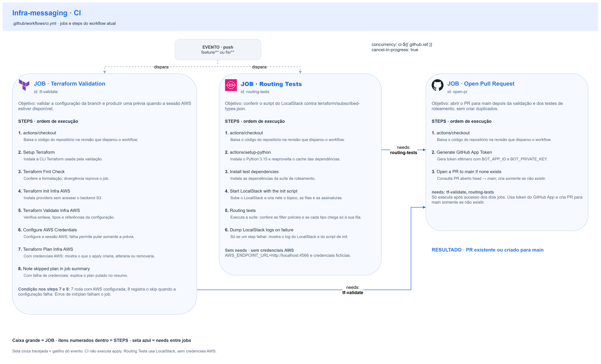
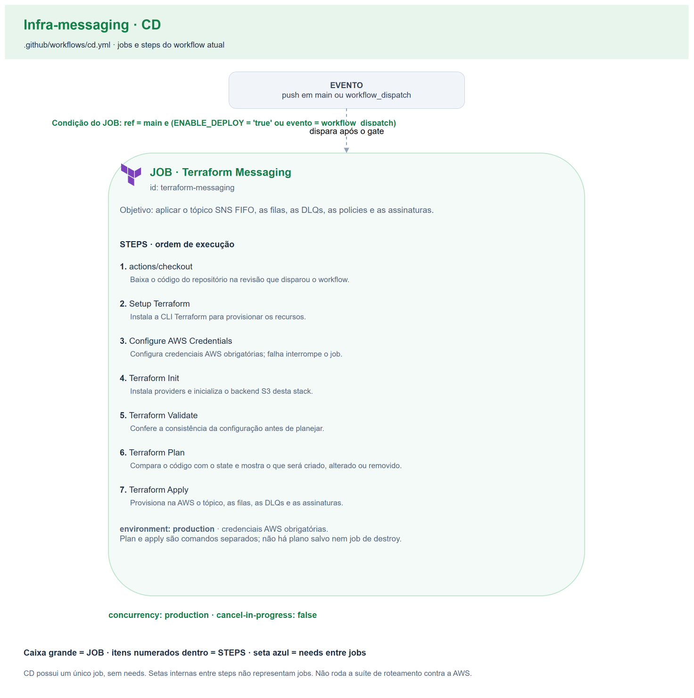

# 🔄 CI/CD — Mensageria AWS

Dois workflows do GitHub Actions, um por responsabilidade: validar a branch e
abrir PR (**CI**), ou aplicar a topologia (**CD**). A fonte executável é
[ci.yml](../.github/workflows/ci.yml) e [cd.yml](../.github/workflows/cd.yml).

## Índice

- [Fluxo de branch e Pull Request](#fluxo-de-branch-e-pull-request)
- [Concorrência, permissões e ambiente](#concorrência-permissões-e-ambiente)
- [1) Workflow de CI](#1-workflow-de-ci)
- [2) Workflow de CD](#2-workflow-de-cd)
- [Ruleset da main](#ruleset-da-main)
- [Secrets e Variables](#secrets-e-variables)
- [Limites da validação e ciclo do laboratório](#limites-da-validação-e-ciclo-do-laboratório)

| Workflow | Arquivo | Gatilho | Responsabilidade |
| --- | --- | --- | --- |
| CI | `ci.yml` | `push` em `feature/**` e `fix/**` | fmt, init estático e validate; plan quando há credenciais AWS; suíte de roteamento contra o LocalStack; abertura idempotente de PR para `main` |
| CD | `cd.yml` | `push` em `main` ou `workflow_dispatch` | init, validate, plan e apply da topologia, com gate por branch e variável de deploy |

**Como ler os diagramas:** cada caixa grande é um **job**; seus **steps** estão
enumerados dentro dela, na ordem do YAML. A seta entre jobs indica `needs`.
Gatilho e resultado são eventos, não jobs. Não há `workflow_run` nem
dependência `needs` entre os dois workflows.

## Fluxo de branch e Pull Request

O CI roda a cada push em uma branch `feature/**` ou `fix/**`. Os jobs
`tf-validate` e `routing-tests` rodam em paralelo; se os dois passarem,
`open-pr` consulta PRs abertos da mesma branch para `main`. Se já existir um,
termina sem duplicá-lo; senão, abre o PR.

Não há gatilho `pull_request` neste CI. Um novo push numa branch com PR aberto
reexecuta a validação e mantém o mesmo PR. A automação usa um token efêmero de
**GitHub App**, instalado com acesso ao repositório, gerado a partir da
Variable `BOT_APP_ID` e do Secret `BOT_PRIVATE_KEY`.

## Concorrência, permissões e ambiente

| Workflow | Grupo | `cancel-in-progress` | Efeito |
| --- | --- | --- | --- |
| CI | `ci-${{ github.ref }}` | `true` | Um novo push cancela o run anterior da mesma ref |
| CD | `production` | `false` | Não interrompe um apply em andamento; a entrega seguinte aguarda |

Os jobs usam `ubuntu-latest`. O CI define `permissions: contents: read`; o
`open-pr` usa o token do App para as chamadas de PR, com leitura de Contents e
escrita de Pull Requests.

O job de CD usa `environment: production`, `contents: read` e a condition:

```yaml
github.ref == 'refs/heads/main' &&
(vars.ENABLE_DEPLOY == 'true' || github.event_name == 'workflow_dispatch')
```

O deploy automático exige o valor literal `true` em `ENABLE_DEPLOY`. O disparo
manual aplica com a variável desligada, mas também precisa selecionar `main`.

## 1) Workflow de CI



| Job | Nome exibido | `needs` | Responsabilidade |
| --- | --- | --- | --- |
| `tf-validate` | Terraform Validation | — | Validação estática e plan condicionado às credenciais AWS |
| `routing-tests` | Routing Tests | — | Suíte de roteamento contra o LocalStack do `docker-compose.yml` |
| `open-pr` | Open Pull Request | `tf-validate`, `routing-tests` | Gerar token do App e consultar ou criar PR para `main` |

Cada action de terceiros é fixada por SHA completo no YAML, com a versão em
comentário.

### Job `tf-validate` — Terraform Validation

Os comandos Terraform usam `working-directory: terraform`.

1. **Checkout** (`actions/checkout`): disponibiliza a revisão do push no runner.
2. **Setup Terraform** (`hashicorp/setup-terraform`): instala a CLI Terraform.
3. **Terraform Fmt Check**: `terraform fmt -check -recursive`; divergência de formato falha o job.
4. **Terraform Init Infra AWS**: `terraform init -backend=false -no-color`; instala os providers sem conectar ao backend S3.
5. **Terraform Validate Infra AWS**: `terraform validate -no-color`; confere sintaxe, referências e schemas, inclusive a leitura de `subscribed-types.json` pelo `jsondecode`.
6. **Configure AWS Credentials** (`aws-actions/configure-aws-credentials`, `id: aws_creds`): usa os três Secrets temporários, com `continue-on-error: true`; `steps.aws_creds.outcome` guarda o resultado real.
7. **Terraform Plan Infra AWS**: só com `steps.aws_creds.outcome == 'success'`. Faz `terraform init -reconfigure -no-color -backend-config="bucket=$TF_STATE_BUCKET"` e `terraform plan -no-color`. Uma falha de init ou plan depois de autenticar falha o job.
8. **Note skipped plan in job summary**: só com `steps.aws_creds.outcome == 'failure'`; avisa no `$GITHUB_STEP_SUMMARY` que o plan foi pulado.

Os steps 7 e 8 são caminhos alternativos do mesmo job. Sem credenciais AWS
válidas e com as validações estáticas aprovadas, o job passa sem plan.

### Job `routing-tests` — Routing Tests

Não usa credenciais AWS, então roda mesmo sem credenciais válidas. O `env` do job define
`AWS_ENDPOINT_URL=http://localhost:4566` e as credenciais fictícias
`AWS_ACCESS_KEY_ID=test` e `AWS_SECRET_ACCESS_KEY=test`; o boto3 lê o endpoint
do ambiente.

1. **Checkout**: disponibiliza o script, o mapa e a suíte.
2. **Setup Python** (`actions/setup-python`): Python 3.15, com cache do pip pela chave de `tests/requirements.txt`.
3. **Install test dependencies**: `pip install -r tests/requirements.txt` (boto3 e pytest em versões fixadas).
4. **Start LocalStack with the init script**: `docker compose up -d`; o LocalStack 4.14.0 sobe com `localstack/init-topology.sh` montado em `/etc/localstack/init/ready.d/`.
5. **Routing tests**: `pytest tests -v`. A suíte espera `GET /_localstack/init/ready` responder `completed`, falha se nenhum script de init rodou e falha com `init-topology.sh: <estado>` se o script não terminar `SUCCESSFUL`. Depois confere:
   - por consumidor, que a assinatura tem raw delivery e a filter policy igual à lista do mapa em `terraform/subscribed-types.json`. É esse teste que pega um tipo que o script assina a mais;
   - por tipo do mapa, publicado duas vezes com os mesmos `MessageGroupId` e `MessageDeduplicationId`, que uma única cópia chega só à fila do consumidor, com o corpo e os atributos `type` e `traceparent`;
   - que um tipo fora do mapa não chega a nenhuma fila.
6. **Dump LocalStack logs on failure**: só quando um step anterior falha (`if: failure()`); `docker compose logs localstack` mostra no log do job a saída do script de init, com o comando que falhou.

### Job `open-pr` — Open Pull Request

`needs: [tf-validate, routing-tests]`: só roda com os dois verdes.

1. **Checkout**: disponibiliza o repositório ao `gh`.
2. **Generate GitHub App Token** (`actions/create-github-app-token`, `id: app_token`): gera o token efêmero com `vars.BOT_APP_ID` e `secrets.BOT_PRIVATE_KEY`.
3. **Open a PR to main if none exists**: com `set -euo pipefail`, consulta `gh pr list --head "$HEAD_BRANCH" --base main --state open`. Com PR aberto, sai com sucesso; senão, `gh pr create` abre o PR com a branch como título.

## 2) Workflow de CD



| Job | Nome exibido | `needs` | Ambiente |
| --- | --- | --- | --- |
| `terraform-messaging` | Terraform Messaging | — | `production` |

### Job `terraform-messaging` — Terraform Messaging

1. **Checkout**: obtém a revisão de `main`.
2. **Setup Terraform**: instala a CLI Terraform.
3. **Configure AWS Credentials**: configura os três Secrets temporários e `us-east-1`, sem `continue-on-error`.
4. **Terraform Init**: `terraform init -no-color -backend-config="bucket=$TF_STATE_BUCKET"` em `terraform/`.
5. **Terraform Validate**: `terraform validate -no-color`.
6. **Terraform Plan**: `terraform plan -no-color`.
7. **Terraform Apply**: `terraform apply -auto-approve -no-color`; cria ou atualiza o tópico, as filas, as policies e as assinaturas, e publica os outputs lidos pela Lambda de notificação.

Uma falha interrompe a sequência. O CD não roda a suíte de roteamento contra a
AWS: com serviços e Lambdas no ar, eles consumiriam as mensagens de teste. A
suíte contra a AWS é manual e segue o [runbook](runbook.md#suíte-de-roteamento-contra-a-aws).
`TF_IN_AUTOMATION=true` é definido no CD.

## Ruleset da main

| Regra | Valor |
| --- | --- |
| Alvo | Branch padrão (`~DEFAULT_BRANCH`), `enforcement: active` |
| Bypass | Nenhum |
| Pull request | Obrigatório, sem aprovação mínima |
| Force push e exclusão | Bloqueados (`non_fast_forward`, `deletion`) |
| Checks obrigatórios | `Terraform Validation` e `Routing Tests` |

Para conferir:

```bash
gh api repos/FIAP-15SOAT/oficina-mecanica-infra-messaging/rulesets
```

## Secrets e Variables

| Tipo | Nome | Usado em | Finalidade |
| --- | --- | --- | --- |
| Secret | `AWS_ACCESS_KEY_ID` | `tf-validate` e CD | Access key temporária do laboratório |
| Secret | `AWS_SECRET_ACCESS_KEY` | `tf-validate` e CD | Secret key da mesma sessão |
| Secret | `AWS_SESSION_TOKEN` | `tf-validate` e CD | Token temporário da mesma sessão |
| Variable | `TF_STATE_BUCKET` | `tf-validate` e CD | Bucket de state, passado ao `terraform init` por `-backend-config` |
| Variable | `BOT_APP_ID` | `open-pr` | ID do GitHub App |
| Secret | `BOT_PRIVATE_KEY` | `open-pr` | Chave privada do GitHub App |
| Variable | `ENABLE_DEPLOY` | Condition do CD | `true` habilita o deploy automático |

Os Secrets e as Variables são da organização, exceto `ENABLE_DEPLOY`, do
repositório. O `routing-tests` não usa nenhum deles.

## Limites da validação e ciclo do laboratório

- `fmt`, init sem backend e `validate` são estáticos; não confirmam permissões nem o plan.
- O plan do CI é pulado quando a configuração de credenciais falha; depois de autenticar, falha de state ou de API falha o job.
- O `Routing Tests` confere o script do LocalStack contra o mapa, não a AWS. O LocalStack não aplica a policy de fila, então um `aws:SourceArn` errado só aparece na suíte contra a AWS.
- Não há workflow de destroy. A ordem de subida e derrubada está no [runbook](runbook.md#subida-e-derrubada).

Decisões relacionadas: [ADR 0001](adr/0001-um-topico-fifo-e-uma-fila-por-consumidor.md) e [ADR 0002](adr/0002-mapa-unico-de-tipos-e-script-local.md).

Voltar ao [README](../README.md).
